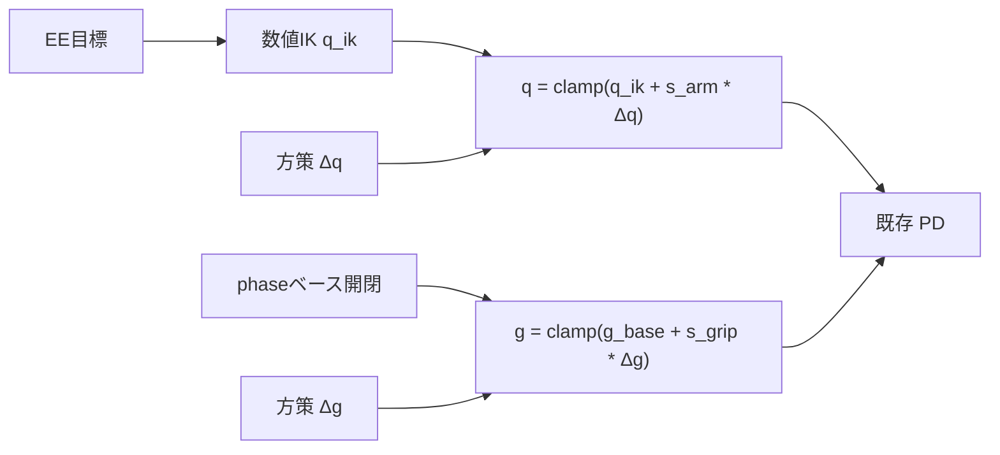

# 腕・グリッパを IK＋残差 RL に改修

## 方針（確定）

- **範囲**: `reach` / `haul` / `carry` / `catch` を一括切り替え（`walk` は従来どおり `holds_arm_pose` で腕を方策外）
- **腕**: 環境が EE 目標へ数値 IK → `q_ik`。方策の 6 次元は `Δq`（狭いスケール）
- **グリッパ**: 段階・phase から開閉ベース `g_base`。方策の 1 次元は小さな `Δg`
- **行動次元は 17 のまま**（CPG 10 + arm 6 + grip 1）。意味だけ変わるため、腕段階の旧チェックポイントは非互換と明記

## EE 目標の決め方

環境内ヘルパ `_arm_ik_target()`（ベース座標 or 世界座標を統一）:

| 段階 | 目標 |
| --- | --- |
| `reach` | `reach_target` / `ball_pos` |
| `haul` / `carry` phase 1（拾う） | 箱 `obj_pos`（把持高さオフセット可） |
| `carry` phase 3（置く） | `goal_pos` 上方 |
| `haul` / `carry` phase 0・2（歩行中） | 胴前のキャリー姿勢点（固定オフセット） |
| `catch` | ボール位置（必要なら短予測を既存 command と揃える） |

到達不能時は前回 `q_ik` または `default_arm` にフォールバックし、IK 残差ノルムを extras に記録。

## グリッパベース（2-C）

既存の split ロジックをベース指令に昇格（[`arm_gripper_command`](pick_and_carry/control.py) の phase 分岐を再利用）:

- phase 0: 開
- phase 1: 方策寄りだがベースは「閉じ方向へ寄せる」または中間
- phase 2: 閉
- phase 3: 開（放す）
- `reach` / `catch`: 接近時は開ベース、保持成功近傍は閉ベース（既存 `manipulation_reward` / grasp 判定と整合）

最終: `g = clamp(g_base + grip_residual_scale * Δg)`。

## 実装ファイル

1. **新規** [`pick_and_carry/ik.py`](pick_and_carry/ik.py)
   - Z1 の簡易 FK（URDF  orth からリンク長・軸を固定テーブル化、または既存 `default`＋回転合成）
   - 減衰最小二乗の反復 IK（torch、Genesis 非依存 → 単体テスト可）
   - `solve_ik(q0, target_xyz, lower, upper) -> q_ik`

2. **改修** [`pick_and_carry/control.py`](pick_and_carry/control.py)
   - `arm_gripper_command` を `arm_residual_command(q_ik, arm_act, …)` / `gripper_residual_command(g_base, grip_act, …)` に分割または拡張
   - `arm_scale` 既定を残差用に縮小（例: `0.12` rad）。設定は [`config.py`](pick_and_carry/config.py) の `arm_action_scale` / 新規 `gripper_residual_scale`

3. **改修** [`pick_and_carry/env.py`](pick_and_carry/env.py) の `_apply_action`
   - `holds_arm_pose` 分岐は維持
   - それ以外: `_arm_ik_target()` → IK → 残差合成 → 既存 `control_dofs_position`
   - 観測の `last_leg_action` は脚のまま。必要なら extras に `ik_error` を追加（観測 81 は維持しチェックポイント次元を崩さない）

4. **テスト** [`tests/test_ik.py`](tests/test_ik.py) + [`tests/test_arms.py`](tests/test_arms.py) / control 系
   - FK∘IK で目標近傍に収束
   - 残差ゼロなら指令 ≈ `q_ik` / `g_base`
   - 残差クリップが関節限界内

5. **文書**
   - README / [`scripts/make_summary_slide.py`](scripts/make_summary_slide.py) の制御説明を「腕・指は IK＋残差」に更新
   - 旧純 RL 腕重みは reach 以降で使えない旨を短く記載

## 学習上の注意

- 初期ノイズ（[`initial_action_std`](pick_and_carry/train_ppo.py)）の腕・指は小さめのまま／さらに縮小
- BC/GAIL は現在トロット脚向け。腕残差の教師は当面なし（reach 以降は PPO から）
- 報酬式は据え置き（手先距離など）。IK ベースで到達が楽になる分、残差は接触微調整・追従遅れ補償に寄与

## 検証

- 単体: IK / 残差合成
- 短時間 reach play（ゼロ方策 ≈ 純 IK）で手先が点に寄るか目視
- その後 reach → haul → carry の順に学習
