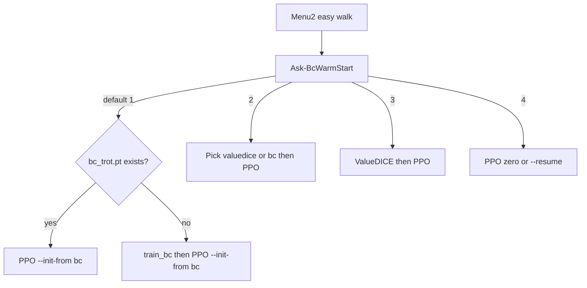

# メニュー2暖気フロー改善

## 方針

会話の結論どおり、**歩行改善の本線は BC → PPO**。ValueDICE はメニュー1の模倣実験用に残し、メニュー2では「任意の上級」に下げる。コード変更はランチャー中心（[scripts/PickAndCarry_run.ps1](scripts/PickAndCarry_run.ps1) と [launcher/PickAndCarry_run.ps1](launcher/PickAndCarry_run.ps1) を同期）。デスクトップ起動コピーも同じ内容に揃える。

## 変更内容

### 1. `Ask-BcWarmStart` の選択肢を再編

現状（既定1が「毎回 BC し直し」）:

1. BC してから PPO  
2. ValueDICE してから PPO  
3. 既存重みから PPO  
4. ゼロから  

変更後（既定1が最短有望パス）:

1. **保存 BC があればそれを使って PPO**（無ければ BC を実行してから PPO）← 既定・推奨  
2. **既存の模倣／PPO 重みから選んで PPO**（`bc_trot.pt` / `valuedice_trot.pt` / `ppo_*`。優先順は **BC → ValueDICE → PPO続き** を明示。両方あるときは従来どおり続き vs 暖気し直しを質問）  
3. **ValueDICE してから PPO**（上級・任意）  
4. **ゼロから PPO**

フラグ運用:

- 既定1で BC ファイルあり → `initFromArgs = --init-from <bc絶対パス>`、`runBcFirst=$false`  
- 既定1で BC なし → 現行どおり `runBcFirst=$true`  
- 3 → 現行 `runGailFirst`（ValueDICE）パス  
- ValueDICE 完了後の PPO は現状維持（`--init-from valuedice_trot.pt`）

### 2. メニュー2本体のメッセージ

[scripts/PickAndCarry_run.ps1](scripts/PickAndCarry_run.ps1) の `"2"` 分岐付近:

- 簡単歩行時の説明を「推奨: 保存BC→PPO。ValueDICEは任意」に更新  
- トップのメニュー説明（模仿／学習の案内文）も一行だけ整合

### 3. 同期

- [launcher/PickAndCarry_run.ps1](launcher/PickAndCarry_run.ps1) に同一変更  
- `C:\Users\xeno1\Desktop\起動スクリプト\PickAndCarry\PickAndCarry_run.ps1` へコピー

## やらないこと

- DAgger 新規実装（メニュー1側の別作業）  
- `train_ppo.py` の学習ハイパーパラメータ変更（今回は導線改善に限定）  
- GRPO / Sym PPO のアルゴリズム本体変更

## 確認

- メニュー2 → 歩行 → 簡単 → Enter（既定1）で、`bc_trot.pt` があるとき `--init-from ...\bc_trot.pt` のみで PPO が始まること  
- BC が無いときだけ BC → PPO になること  
- ValueDICE 経路（選択肢3）が従来どおり動くこと
