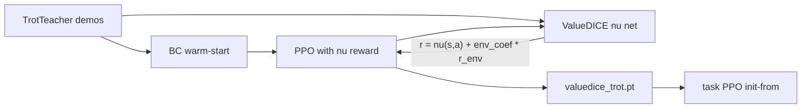

# ValueDICE で GAIL 枠を置換する

## 方針

- 目的は **PPO 暖気用模倣の安定化**（識別器飽和で歩容が崩れる問題を避ける）。
- **GAN 識別器を廃止**し、ValueDICE の ν(s,a) 双対更新＋ν 由来報酬で PPO を回す。
- 既存の **BC 暖気・教師デモ収集・`ActorCritic` チェックポイント形**はそのまま使う。
- ランチャー／init-from の「GAIL 枠」を ValueDICE に差し替える（後方互換で旧 `gail_trot.pt` も読める）。

## 実装

### 1. ValueDICE コア

新規 `[pick_and_carry/valuedice.py](pick_and_carry/valuedice.py)`:

- `NuNet(obs_dim, act_dim)` … 現状の `Discriminator` と同規模 MLP（256×256）
- `train_nu(...)` … 専門家バッチと方策ロールアウトで双対損失を最小化  
実用形（論文の off-policy ValueDICE を、いまの on-policy バッファに合わせた形）:
  - `L = E_π[exp(ν - 1)] - E_E[ν]`（必要なら ν クリップ／勾配ノルムで安定化）
- `valuedice_reward(obs, act)` … PPO 用スカラー報酬（`ν` をそのまま、または `clamp` してスケール安定化）
- 既存の `apply_action_mask` を再利用（脚 CPG 以外を imitation から除外）

### 2. 学習エントリ

`[pick_and_carry/train_gail.py](pick_and_carry/train_gail.py)` を **ValueDICE 既定**に改修（ファイル名はランチャー互換のため残すか、`train_valuedice.py` を本体にして `train_gail` から委譲）:

- `run_gail` → `run_valuedice`: ロールアウト中の報酬を `disc.gail_reward` から `nu` 報酬へ
- 各 iteration: `train_nu`（旧 `train_discriminator`）→ GAE → `ppo_update`（既存）
- CLI: `--disc-*` を `--nu-epochs` / `--nu-lr` / `--nu-batch-size` に置換（旧名はエイリアス可）
- `--gail-coef` → `--imit-coef`（エイリアス `--gail-coef`）
- `--env-coef` は維持（walk 環境報酬ミックス）
- 保存: 主成果物 `[valuedice_trot.pt](logs/ppo_curriculum_walk_easy/valuedice_trot.pt)`、中間 `valuedice_XXXXXX.pt`  
チェックポイントは現行どおり `model` + `obs_dim`/`act_dim`/`arm`/`bc_trot` 相当フラグで **PPO `--init-from` 互換**
- ログ: `r_nu` / `r_env` / `r_mix` / `nu_loss`（MLflow + 色付きコンソール）

### 3. ランチャー・init 優先順位

`[scripts/PickAndCarry_run.ps1](scripts/PickAndCarry_run.ps1)`:

- メニュー文言を「GAIL」→「ValueDICE（旧 GAIL 枠）」に更新
- `Ask-DiscEpochs` → `Ask-NuEpochs`（既定 4）
- 学習コマンドを `train_gail`（内部 ValueDICE）または `train_valuedice` に合わせる
- 暖気 init 優先: `**valuedice_trot.pt` → `gail_trot.pt` → `bc_trot.pt**`
- `[pick_and_carry/train_ppo.py](pick_and_carry/train_ppo.py)` の easy-walk 自動 `--init-from` も同じ順

### 4. テスト・ドキュメント

- `[tests/test_valuedice.py](tests/test_valuedice.py)`: マスク適用、ν 損失が有限、報酬 shape、乱数データで 1 step 更新が落ちないこと
- README の模倣節を ValueDICE に更新（BC → ValueDICE → PPO）
- 旧 `gail.py` は削除するか、薄い互換ラッパに縮小（新規経路は ν のみ）

## 成功条件

- 識別器 `disc_acc≈1` 飽和が起きない（指標は `nu_loss` / `r_nu`）
- `valuedice_trot.pt` から PPO が iteration 0 で暖気起動できる
- stand/stop コマンド保持時に amp ゲートが閉じたまま（既存 hold 修正と併用）

